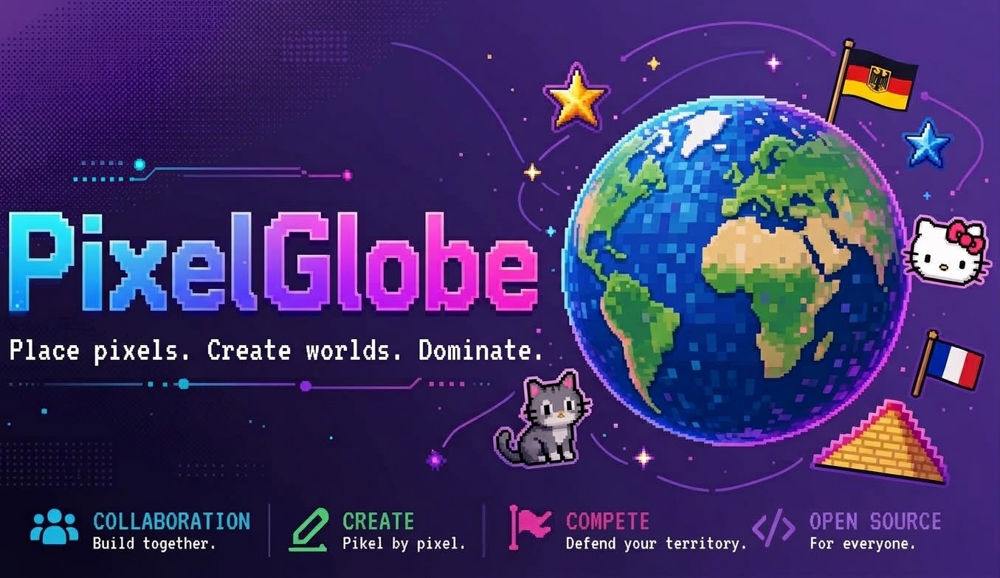

<p align="center">
  
</p>

<p align="center">
  <a href="LICENSE"></a>
  <a href="https://nodejs.org"></a>
  <a href="https://www.postgresql.org"></a>
  <a href="https://discord.gg/XWvCePwtUZ"></a>
  <a href="https://mariadb.org"></a>
  
  
</p>

<h1 align="center">PixelGlobe — Place pixels. Create worlds. Dominate.</h1>

<p align="center">
  The official open-source repository of <a href="https://pixelglobe.fun"><b>pixelglobe.fun</b></a><br>
  A collaborative pixel canvas inspired by <b>r/place</b> and <b>pixelplanet.fun</b> — rebuilt, faster, and open.
</p>

<p align="center">
  <a href="#-features">Features</a> •
  <a href="#-quick-start">Quick Start</a> •
  <a href="#-configuration">Config</a> •
  <a href="#-api">API</a> •
  <a href="#-contributing">Contributing</a> •
  <a href="https://discord.gg/XWvCePwtUZ">Discord</a>
</p>

---

### ✨ What is PixelGlobe?

PixelGlobe is a **massively collaborative pixel art experiment**. A huge world map (65k × 65k) and a 3D globe where anyone can place a pixel, build alliances, draw flags, meme, or wage faction wars — **together, in real time**.

> Born from the spirit of r/place's 2nd anniversary, reimagined for the next generation: no paywalls, no closed beta, 100% open source.

*   **One giant canvas** — 65,536 × 65,536 pixels. A full world map *and* a 3D voxel globe.
*   **30 hand-picked colors** — voted by the community.
*   **3s / 5s cooldown** — 3 seconds on empty, 5 on overwrite. Stack up to a minute so you don't have to wait every time.
*   **Live for everyone** — WebSocket sync, zero refresh needed.

<p align="center">
  
  <br>
  <em>Albania, Hellas, and a lot of chaos — drawn by real players.</em>
</p>

---

### 🚀 Features

PixelPlanet was the foundation. PixelGlobe is the evolution.

| Category | PixelPlanet | **PixelGlobe** |
| :--- | :--- | :--- |
| **Canvas** | 1 world | **Multiple worlds + 3D globe + custom canvases** |
| **Minimap** | Static image | **LIVE minimap — real tiles, 1s polling, 4 zoom levels** |
| **Paste** | Exact-color only | **Smart paste — closest-color fallback + alpha fix** |
| **Communication** | Chat | **Chat + GIF (KLIPY) + Voice/Screen Share** |
| **Admin** | Basic modtools | **MEGA Admin: IP Ban, Device Fingerprint Ban, Mute, Live Ban List, Pixel Inspector, IP Intel (VPN/Tor/Proxy)** |
| **Security** | CAPTCHA | **EntryCheck (Captcha + JS Challenge) + NetGuard + MassRateLimiter + ProxyIntel** |
| **Economy** | — | **Market + Wheel + Pulse + Faction Wars + Chaos Events** |

#### 🎮 Gameplay
- Faction system with roles, invites, bans and hidden members
- Templates & overlays — import any image, auto-quantized to the 30-color palette
- Chat channels (`en`, `int`, `art`), DMs, @mentions, markdown, media embeds (YouTube, TikTok, Twitch…)
- Fishing, badges, leaderboards, daily pulses

#### 🛡️ Moderation & Intel
- **Pixel Inspector** — click any pixel → who placed it (name, ID), **IP, country, ASN, device fingerprint, proxy verdict**
- **IP Scan** — `Admin → IP Scan` → `VPN / Tor / Proxy / Hosting / Bot` detection via `Proxies` table + `proxycheck.io`
- **Ban types:** User ban, IP ban, Device ban (fingerprint), Mute, Whitelist. All with duration or permanent.
- **Live Ban List** — table with name/ID/IP/reason/expires/moderator + one-click unban/unmute

#### 🗺️ Live Minimap (our pride)
- 4096² summary, 256² transparent PNG tiles, `?c=<canvas>` multi-world, LRU 4-world cache, 200ms tick, `TILE_CACHE_MAX=192`

---

### 🖥️ Quick Start

#### Requirements
- **Node.js** `>=18` (20 recommended) with `npm`
- **Redis** `>=7` — canvas storage
- **MariaDB / MySQL** — users, bans, IPs
- **pm2** — process manager & logs

#### Building

```bash
# 1. Clone
git clone https://github.com/<you>/pixelglobe.git
cd pixelglobe

# 2. Install & build
npm install
npm run build
# -> all runnable files are generated in ./build
```

> **g++ note:** If `npm install` complains about `g++`, run as root then `chown username:username -R .` after build.

```bash
# 3. Configure
cp ecosystem.example.yml ecosystem.yml
# edit ecosystem.yml — set REDIS_URL, DB creds, etc. (see Configuration below)

# 4. Run with pm2
pm2 start ecosystem.yml
pm2 logs
```

All tiles / assets are generated on first run.

---

### ▶️ Run

| Script | What it does |
| :--- | :--- |
| `npm run build` | Bundles client + server to `./build` |
| `pm2 start ecosystem.yml` | Production run |
| `npm start` | Dev run (no pm2) |
| `npm test` | Runs 846+ tests (see `pgrig/`) |

---

### ⚙️ Configuration

Configuration is **environment variables** defined in `ecosystem.yml` (pm2) or `.env`. You only need to set the `Necessary` ones.

#### Necessary

| Variable | Description | Example |
| :--- | :--- | :--- |
| `PORT` | HTTP port | `80` |
| `HOST` | Bind host | `127.0.0.1` |
| `REDIS_URL` | Redis URL | `redis://localhost:6379` |
| `MARIADB_HOST` | DB host | `localhost` |
| `MARIADB_USER` | DB user | `pixelglobe` |
| `MARIADB_PW` | DB password | `supersecret` |
| `MARIADB_DATABASE` | DB name | `pixelglobe` |
| `COOKIE_SECRET` | **Change this!** Session signing secret | `openssl rand -base64 32` |

#### Optional / Advanced

| Variable | Description | Default |
| :--- | :--- | :--- |
| `BASENAME` | Sub-path if not root | `""` |
| `CDN_URL` | CDN for tiles | `""` |
| `CAPTCHA_TIME` | Captcha expiry (min) | `30` |
| `BLOCK_PROXIES` | Block VPN/proxy entry | `true` |
| `USE_PROXYCHECK` | Enable proxycheck.io | `false` |
| `PROXYCHECK_KEY` | API key | `null` |
| `ADMIN_IDS` | Comma admin IDs | `""` |
| `HOURLY_EVENT` | Hourly events | `false` |
| `FISHING` | Fishing game | `false` |
| `BACKUP_URL` | Tile backup | `null` |

See [`ecosystem.example.yml`](ecosystem.example.yml) and [`config.ini.example`](config.ini.example) for full list.

---

### 🔌 API

| Endpoint | Method | Auth | Description |
| :--- | :--- | :--- | :--- |
| `/api/me` | GET | session | Your session + user |
| `/api/pixelinfo?c=&x=&y=` | GET | mod+ shows IP/proxy | Who placed a pixel |
| `/api/admin/bans?type=` | GET | mod | Live ban list |
| `/api/admin/scan-ip?ip=` | GET | mod | Proxy/VPN/Tor scan |
| `/api/admin/action` | POST | admin | ban/ipban/deviceban/mute/unban |
| `/api/shards` | GET | — | Shard info |
| `/captcha.svg` | GET | — | Captcha image |
| `/challenge.js` | GET | — | JS challenge |
| `/api/entry-check` | POST | — | Captcha+challenge verify |

WebSockets: `/ws` (canvas), `/mcws` (API). All pixels via binary opcode, never counted as DDoS by NetGuard.

---

### 🏗️ Architecture

```
[Client] --WS--> [NetGuard] --> [Express] --> [Redis] (chunks)
                 [SecurityHeaders]       \--> [MariaDB] (users/bans/IPs)
                 [EntryCheck]             --> [PixelInfo] (90d)
                 [RateLimiter]
```

- `src/core/Image.js` — smart paste (closest-color + alpha)
- `src/core/PixelInfo.js` — 90-day pixel ownership + IP
- `src/core/MiniMapLive.js` — 4096 live summary, multi-world
- `src/utils/netguard.js` — sliding-window DDoS shield

---

### 🤝 Contributing

PRs are welcome! This is GPL-3.0 — same as pixelplanet.fun.

1. Fork & create a branch: `git checkout -b feat/awesome`
2. `npm install` & `npm run build`
3. `npm test` — must be **0 failures**
4. Open a PR — describe *why*, not just *what*

See [CONTRIBUTING.md](CONTRIBUTING.md) and [CODE_OF_CONDUCT.md](CODE_OF_CONDUCT.md).

---

### 📄 License

**GPL-3.0** — same as [`pixelplanetdev/pixelplanet`](https://github.com/pixelplanetdev/pixelplanet). You are free to host your own instance, but you **must open-source** your changes under the same license if you distribute.

See [LICENSE](LICENSE).

---

### 💬 Community

Join us on Discord for support, events and faction wars:

**👉 https://discord.gg/XWvCePwtUZ**

---

### 🙏 Credits

- Original idea & base: [pixelplanetdev/pixelplanet](https://github.com/pixelplanetdev/pixelplanet) — Thank you!
- PixelGlobe team — minimap, admin, paste fix, live engine
- Community — for every pixel placed ❤️

<p align="center">
  <b>Place pixels. Create worlds. Dominate.</b><br>
  <sub>Made with 🟦🟥🟨🟩 — PixelGlobe © 2026</sub>
</p>
